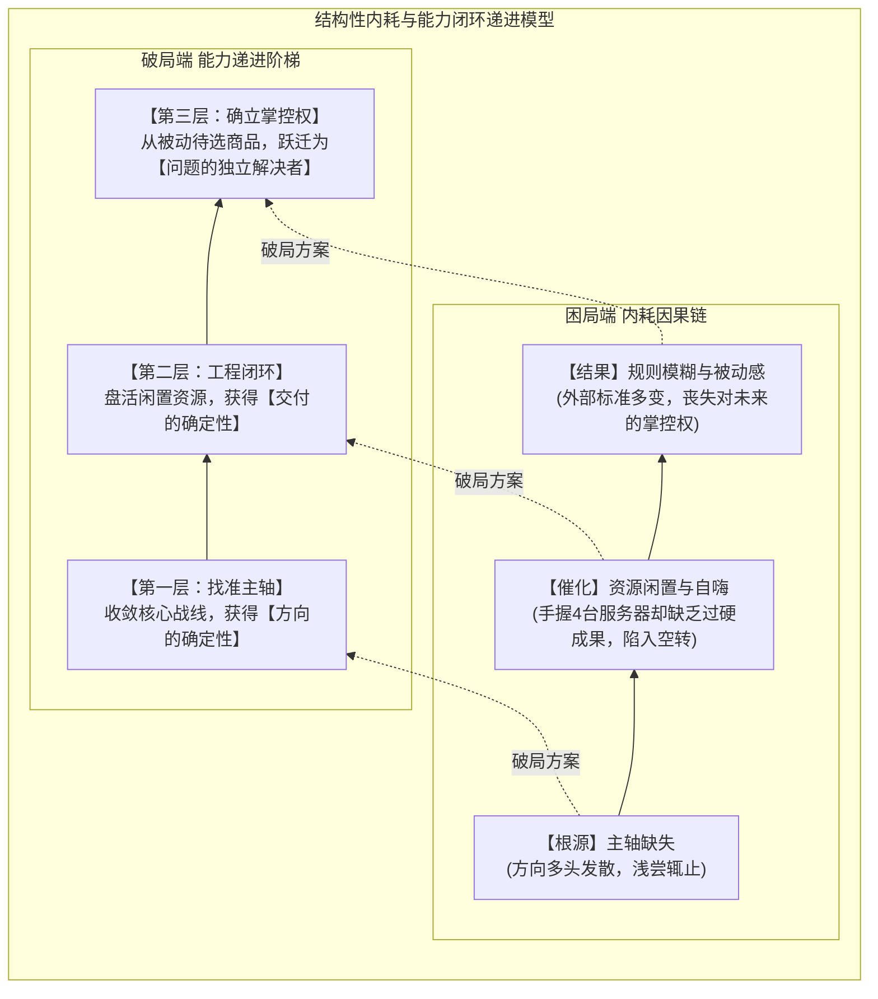
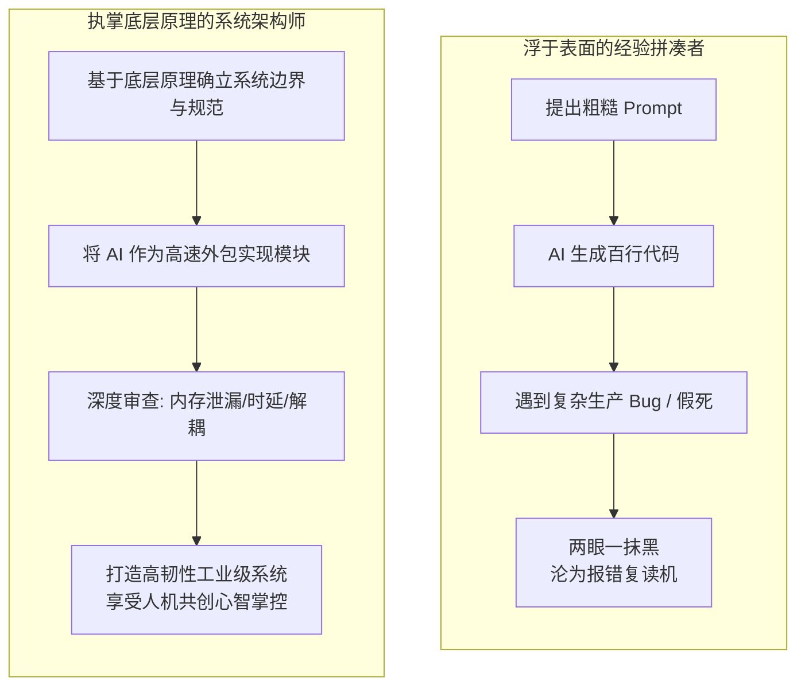
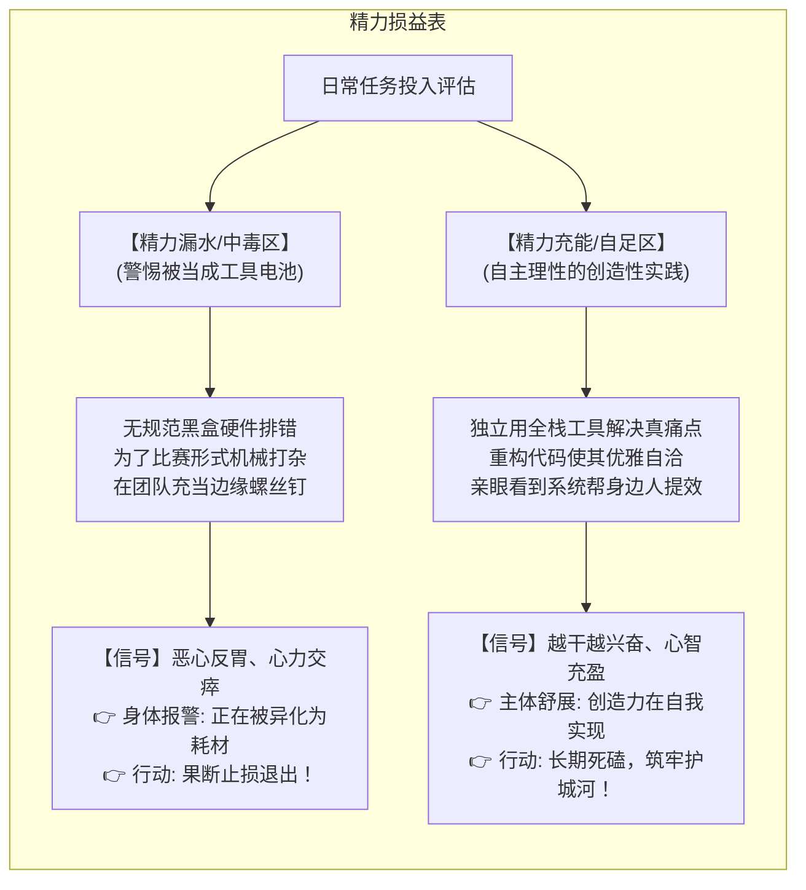
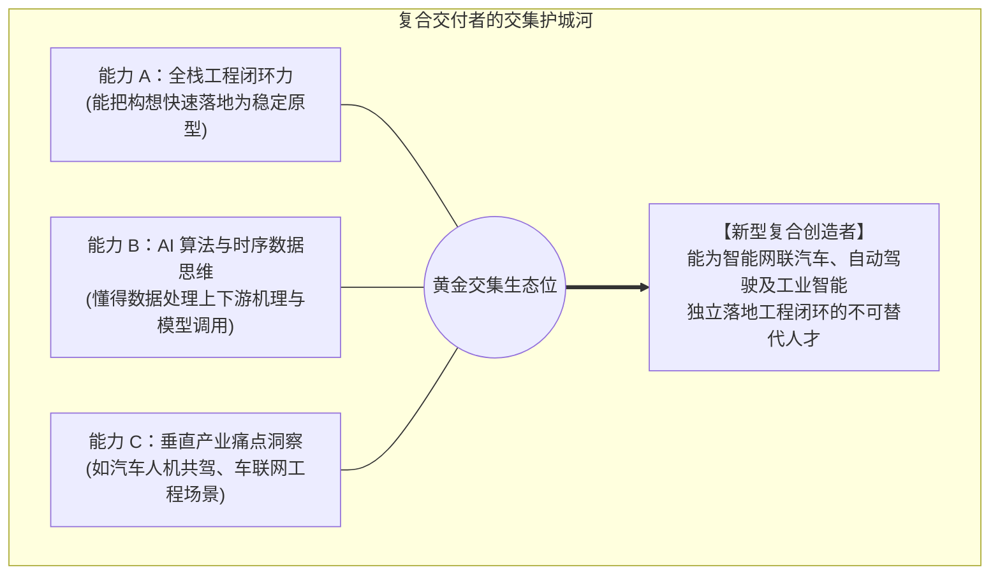
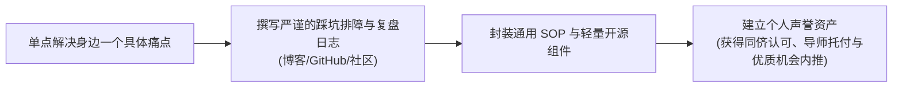

# 当前就业需要什么能力或者履历

> **案例导读**：  
> 这是一篇面向青年开发者、理工科在校生以及所有在职业迷茫期中自我内耗者的提议。  
> 案例中的咨询者是一名工科在读、对全栈开发与人工智能抱有浓厚兴趣，但在传统学科竞赛中遭遇挫败的同学。他有多台服务器与汽车人机共驾课题组的宝贵数据资源，却同时陷入了多重焦虑：技术范式剧变（AI 时代学不学底层语法与操作系统）、外部评价绑架（“大学不打比赛就废了”）、以及长辈的教条建议。

---

## 一、 背景

> **求助内容摘录**：  
> “参加了学科竞赛（比如嵌入式物联网），但是发现非常不感兴趣（因为本人的兴趣方向是 AI、网站前后端、网络等），并且很不擅长。浪费了一整个学期但是连比赛都没赶上，搞得心力交瘁。  
> 但是听说‘大学必须得打比赛’‘到处打比赛的人后面保研还是工作都很有帮助’，也挺焦虑的。  
> 自己非常喜欢做网站开发、做一些小工具，当然也能做一些大项目比如平台数据挖掘分析等等。未来由于想读研，所以进入课题组研究汽车人机共驾，当前在做数据处理和分析工作。  
> 希望未来能够在工作上有更多选择权或者获得更多机会，我应该怎么去提升自己？  
> 我当前最希望的就是能用手头的 AI 和四台服务器做出一些拿得出手的有价值的项目。我是不是走在正确的路上？还有做什么类型的项目更有价值？除开打磨自己的项目，我还能从哪些地方提升自己？  
> 当前 AI 很强大了，我还需要深入学习 Golang、Vue、SQL 等编程语言或者 Linux 系统操作吗？  
> 未来实习真的需要一些比如比赛拿奖的履历吗（这个是听我爸妈说的，总感觉不是很靠谱）？”

---

## 二、 分析与回复

### 导言：成年人蜕变期的必然阵痛

首先，我想先给所有正在经历类似纠结的同学吃一颗定心丸：  
**你在大学中后程感知到的这种剧烈焦虑，绝不是你“退步了”或者“能力不行”，而是你从一个“被动接受既定试卷的标准做题家”，向“必须独自面对充满不确定性的真实成年人”蜕变时，不可避免的心灵阵痛。**

在做题家时代，评价标准是单一且绝对清晰的：期末考多少分、排名多少，有一套明确的算式。但当你走到大学中后段，外部世界的声音瞬间嘈杂起来——辅导员强调综合测评，学长鼓吹学科竞赛，导师看重论文数据，企业紧盯工业级交付，父母则牢牢抓住“红头证书”。

面对四面八方的撕扯，内耗是极其正常的。我当年读大学时也有过完全相同的心路历程：反思自己是不是把宝贵的时间浪费在了修电脑、装系统这些枝微末节上；面对没拿奖的比赛彻夜自责；甚至反复怀疑，我不去跟风挤某些热门赛道，到底是因为自己的傲慢，还是因为清醒的取舍？在那个人生十字路口，没有人能一眼看清终局。

但这位同学身上有一个极其耀眼的闪光点：他不仅敏锐觉察到了自身的痛苦，还冷静盘点了手头的软硬件资产（4 台服务器、AI 辅助工具、人机共驾课题组），更勇敢地发问“我是否走在正确的路上”。这表明他已经具备了超越同龄人的自我反思能力。

要破局，我们不能头痛医头、脚痛医脚，必须先帮他把那些情绪化的焦虑剥开，直击其深层的内耗机理。

---

### 零、 核心需求定位：剥离表层焦虑，你真正渴望的是什么？

审视这位同学提出的五个典型问号：

* *“大学必须得打比赛吗？”*
* *“手头 4 台服务器怎么做出拿得出手的项目？”*
* *“实习真的必须靠比赛拿奖做敲门砖吗？”*
* *“我是不是走在正确的路上？”*
* *“AI 时代还要不要死磕 Golang、SQL 和 Linux 底层？”*

这些问号看似彼此独立，其实全部都是**表象的过敏反应**。这位同学真正陷入的，是一条环环相扣的**“结构性内耗因果链”**：

1. **【根源·方向层】主轴缺失，缺乏定力**：因为不清楚什么样的能力才具备长期穿透力，缺乏一套内生而坚定的个人发展主轴，导致在 AI、全栈、物联网硬件、数据挖掘等多个方向上反复横跳、浅尝辄止；
2. **【催化·执行层】资源闲置，陷入负罪与自嗨**：手握 4 台服务器与课题组平台等优质生产资料，看着机器空转却找不到高价值的转化支点。猜测其可能有“浪费资源罪恶感”，同时在一些折腾环境的琐碎事务上寻找虚假的忙碌感；
3. **【结果·生态层】规则模糊，丧失自主掌控感**：外部评价体系混乱（比赛到底多重要？学底层会不会白费？父母教条对不对？），手中又缺少真正能证明自己实力的硬核交付物，因而在竞争中，陷入被动等待挑选的恐慌。



要斩断恶性循环，这位同学需要的不是一份“今天该学哪门语言”的日常任务清单，而是沿着三层阶梯完成能力的跃迁：

#### 1. 第一层（找准主轴）：收敛战线，破除“方向迷茫” ➔ 获得【方向的确定性】

* **对准痛点**：今天听说比赛吃香就硬着头皮烧录芯片，明天看到 AI 爆发就焦虑要不要手写代码，后天听到长辈念叨可能又全盘怀疑自己。
* **真正需要的**：建立一套**以个人天赋兴趣为底色、以工业真实需求为参照的战略主轴**。一旦确立了“AI + 软件工程闭环”的核心航线，他就拥有了屏蔽外部噪音的定力，不会因为退出一个不适合的硬件比赛而苛责自己“浪费了一整学期”。

#### 2. 第二层（工程闭环）：盘活软硬件资产，破除“资源空转” ➔ 获得【交付的确定性】

* **对准痛点**：守着 4 台服务器和前沿课题组，但手头做过的小脚本、小 demo 都是散兵游勇，无法作为经得起检验的凭据，陷入“守着金矿却只能自嗨”的内疚。
* **真正需要的**：将手头分散的工具高效咬合起来，**从“为了折腾技术而折腾”，彻底转向“为了解决真实工程痛点而交付”**。用一个具备完整业务闭环的扎实代表作，彻底终结资源闲置的心理负担。

#### 3. 第三层（确立掌控权）：超越依附思维，破除“规则焦虑” ➔ 获得【人生的自主权】

* **对准痛点**：面对各方考核标准的撕扯，总在揣测“导师喜欢什么、HR 看重什么、父母想要什么”，始终将自己放在被动等待挑选的弱势位置。
* **真正需要的**：不再把人生寄托在猜度外部微观规则的涨落上，而是**在汽车人机共驾的学术场景与软件系统工程能力之间，打磨出一手不可替代的招牌绝活**。当他不仅能懂智能算法与行车场景，还能亲手实现端到端的系统工程落地时，他在任何理性的导师或科技雇主面前，都将彻底摆脱“被挑选的商品”视角，转型为一名**“能独立定义问题、攻克难题的自主创造者”**。

---

### 一、 破除伪需求：为什么“大学是否必须打比赛”是一个劣质命题？

这位同学因劳心费力但比赛都没赶上而产生的心理痛苦，很大程度上源于他不加审视地吞下了一句校园神话：*“大学必须打比赛，没有比赛获奖未来保研找工作就废了。”*

我们需要帮他用理性的解剖刀切开这个命题：

1. **企业导师与技术面试官真正购买的是什么？**  
   没有任何成熟的技术主管或导师会迷信“比赛”这两个字本身。他们在简历中寻找的，是比赛背后所**折射出的底层核心特质**，其中包括：
   * 在充满不确定性的现实中，能否从零到一推进复杂任务的**工程落地能力**；
   * 遭遇棘手 Bug 与系统崩溃时，能否沉下心排障定位的**抗压韧性**；
   * 团队协作中是否言出必行、有始有终的**交付可靠性**。
2. **比赛是证明这些能力的唯一凭证吗？**  
   **绝对不是。** 一个在 GitHub 上被数十人使用并持续维护的开源小工具、一个真正在实验室内部署运行并帮师兄师姐提效的数据清洗服务、一篇详尽复盘复杂分布式网络排障的长文博客，其含金量在懂行的技术官眼中，远远碾压水赛里靠指导教师挂名混来的一纸二三等奖。

**那么，为什么校园里会盛行这种教条？**  
原因非常简单：对于绝大多数没有独立项目构思、缺乏工程内驱力的同学来说，跟着既定比赛的赛题跑，是成本最低、最容易获得外力推着走的训练方式。因此，对于缺乏自主性的群体，打比赛确实是锻炼能力、拿到背书的快捷渠道；**但如果你已经在真实课题组中拥有更贴近工业前沿的真场景、真数据，还回过头去硬凑毫无兴趣的比赛，那就是本末倒置、买椟还珠。**

---

### 二、 技术辨析：AI 时代，底层语言、网络与设计模式还需要深入学吗？

面对强大的人工智能代码生成能力，这位同学产生了极具时代代表性的困惑：“AI 已经能写大部分代码了，我们还需要深入学习 Golang、Vue、SQL 或 Linux 系统操作吗？”

**如果你打算在本领域长期走下去，答案斩钉截铁：必须深入学。但你的学习心态必须完成一次彻底的范式跃迁——从一个“熟练敲代码的手写员”，转向“给系统立规矩的立法者与鉴别师”。**

#### 1. “高级预制菜厨师”

这里有一个非常生动的比喻：

* **AI 就像工业级的洗菜切菜机，以及品质极高的高级预制菜包**。如果一个人对编程的理解仅限于抄模板、调库、写常规增删改查（CRUD），那他充其量只是一个撕开料理包倒进锅里的组装工，随时会被更高效的自动化机器取代；
* 但必须清醒地认识到：**AI 绝不仅仅是洗菜机，它本身也是一位博览人类数千万食谱、技艺精湛的卓越数字大厨！** 它能秒级生成极其惊艳的代码片段。
* 既然 AI 已经是如此厉害的大厨，为什么我们自己还要痛苦地啃操作系统、内存结构、网络拥塞协议以及设计模式呢？

**答案有两个极其深刻的维度：**

* **维度一：从工程本质来看——底层原理与设计模式，是人类为计算系统立下的“最高秩序法则”**。  
  AI 生成的代码本质上是基于海量历史语料的概率拼装，它在现象界看似完美，但在超长链路、高并发和未知边缘场景下，极易产生致命的幻觉与隐蔽死锁。  
  * 懂数据结构与算法时空复杂度，你才能看出 AI 生成的代码在面对百万级流量时会不会导致 CPU 跑满；
  * 懂 Linux 内存模型与网络协议栈，你才能在生产环境容器假死、网络丢包时直捣病灶；
  * **懂设计模式（开闭原则、解耦、状态机），你才是在为庞大的系统搭建一副“抗脆弱的骨架”**。很多优秀架构师在系统的需求设计阶段（Plan），就已经凭借对基础模式与数据流转的深刻理解，笃定了这个系统能够承受未来的业务演化。这些底层通用规范，是人类对抗系统失控熵增的核心屏障。

* **维度二：从人自身的角度来看——通晓万物运行的机理，是对自我心智的一大犒赏！**  
  学习不只是为了迎合劳动力市场的功利算计。人类探索未知的最大乐趣，本就在于穿透混沌表面、看清底层本质时的豁然开朗。  
  当你真正弄懂了一条网络数据包如何穿过物理网卡、经过内核路由最终到达应用进程，当你深刻领会了为什么好的设计模式能让代码如诗歌般优雅自洽时，你的心智获得了前所未有的舒展与笃定。  
  **唯有自己拥有深厚的底蕴，你才有资格与 AI 这位数字大厨平起平坐地品鉴、启发、纠偏与共创；否则，你将永远沦为一个在未知报错里战战兢兢、连菜品变质了都不知道哪味香料放错的盲目侍应生！**



#### 2. 核心技术壁垒对比清单

| 技能领域          | AI 能高效代劳的（初阶代码生成）                   | 掌握底层科学与模式才能胜任的（核心壁垒-其实笔者也没有掌握🤡） |
| :---------------- | :------------------------------------------------ | :----------------------------------------------------------- |
| **Linux 系统**    | 编写一条基础 Dockerfile，给出一两条常规巡检脚本。 | **复杂生产环境排障**：诊断内存逃逸与泄漏、定位进程死锁、分析跨网卡丢包瓶颈、配置服务器集群的安全拓扑与性能限流。 |
| **SQL / 数据库**  | 快速写出常规的多表 `JOIN`、窗口函数与统计查询。   | **数据架构设计与一致性保障**：高并发行级锁冲突化解、复合索引失效机理、时序数据的高效分表归档与分布式缓存强弱一致性权衡。 |
| **Golang / 架构** | 根据 API 规范秒级生成 CRUD 控制器与数据结构体。   | **高并发韧性与架构模式**：Goroutine 泄漏排错、Channel 死锁预防、优雅解耦业务边界，利用依赖倒置设计易于维护的微服务。 |
| **Vue / 前端**    | 迅速生成漂亮的 UI 布局、表单组件与基础样式。      | **全链路状态机与端到端体验**：复杂时序数据的端上渲染性能优化、弱网恶劣环境下的优雅降级容灾与本地离线持久化。 |

---

### 三、 告别“能力陷阱”：手头 4 台服务器与 AI 怎样才算“拿得出手”？

手握 4 台服务器与 AI 工具，这位同学满怀热情想做出“拿得出手的成果”。但在采取行动之前，请先警惕技术爱好者极易跌入的**三大能力陷阱**：

1. **拥有工具 ≠ 拥有价值**：手里握着一把极其锋利的电锯，不代表你必须把家里的好桌子锯成木桩。服务器和算力只是生产工具，企业与高校评审衡量一个项目的价值，看的是**“它解决了谁的真实痛点、带来了多大的效率提升”**，而不是开发者烧掉了多少度电。
2. **拥有工具 ≠ 必须强行用满当前工具**：手里握着一把菜刀，现在需要砍大树，你不应该陷入“既然有菜刀不用岂不可惜”的自嗨陷阱，而是应该放下菜刀去寻找斧头或电锯。很多老程序员过去深耕 PHP+jQuery，当现代 Vue/React 与 Go 栈在并发和工程化上明显更轻量可控时，果断拥抱更合适的工具，远胜于在原有舒适区里死磕。
3. **把“搭建中间流程”误当成“交付实际价值”**：  
   这是无数技术爱好者最容易自我感动的误区。看看这几个可能发生的场景：
   * *案例 A*：原本雄心勃勃要跑数据分析，结果花了两整周折腾 Python 多版本管理、重装显卡驱动和 Docker 容器，最后真实数据一行都没跑；
   * *案例 B*：搭建个人技术博客，花了一个月精细雕琢页面动效、悬浮发光边框和炫酷插件，结果三年过去，博客里只有初始创建时的一篇《Hello World》；
   * *案例 C*：拥有多台服务器，耗费海量精力配置了 Prometheus 监控仪表盘、复杂的内网穿透和 Kubernetes 集群，但这些机器平时除了几个空跑的基础容器，没有任何真实业务流量，甚至连同门需要的一份自动化数据处理脚本都没跑过。  
     **折腾环境与运维带来的“忙碌感”，绝不等于真实的工程交付。**
   * *案例D*：为了追女友，决定把成绩提高；然后为了提高成绩，担心女友打扰，决定删除她的微信。

#### 价值三阶金字塔：什么样的项目具有杀伤力？

```
       ▲
      / \     【三阶：真实业务闭环】拥有真实外部用户或科研场景使用，产生持续数据回流与现实生产力飞跃
     /   \    【二阶：工程韧性完备】具备系统级容错、日志追踪、自动化发布，经得起生产环境并发与异常测试
    /     \   【一阶：本地玩具代码】仅在个人电脑本地勉强跑通 Demo，无异常处理，代码黑盒，无实际应用价值
   ---------
```

**对这位同学的落地建议（盘活课题组杠杆）：**  
该同学目前在课题组研究**“汽车人机共驾”**，同时兼备**全栈开发与数据分析**的兴趣，这是极度稀缺的**交集生态位**！

* **不要去做**：又一个平庸的图书管理系统、个人博客套壳、或者网上烂大街的纯调用第三方 API 的 AI 聊天窗。
* **应该去做**：
  * **第一阶段（敏捷痛点）**：深入观察课题组日常的枯燥机械重复劳动（例如：大量行车实验数据清洗耗费人力、实验标注标准不一）。利用全栈能力与轻量 AI，花两周搭建一个内网可用的**“行车数据辅助标注与格式清洗小工具”**，实实在在地让同门师兄师姐的标注效率提升一倍；
  * **第二阶段（工业级平台闭环）**：依托手头的 4 台服务器作为小型分布式集群，打磨**“人机共驾仿真时序数据可视化与自动化评测平台”**（前端直观展示多模态行车轨迹、驾驶员眼动与手势时序热力图；后端接入高吞吐消息管道；多服务器承担并发清洗与离线挖掘微服务）。
  * 这样的成果一旦交付，不仅在课题组内部是不可替代的生产力资产，未来写进求职简历或升学申请书中，更能在 30 秒内向任何挑剔的考官证明两件事：**你深谙复杂垂直行业的业务场景**，并且**你拥有亲手把架构图变为高可靠运行系统的真功夫**。

---

### 四、 为什么你总在内耗？用“精力损益表”给生活断舍离

很多人在考虑放弃一项消耗巨大却毫无产出的事情时（例如参加到一半的鸡肋比赛），往往会陷入强烈的自责与内疚，骂自己“做事没恒心、意志力不坚定”。

但我们需要给所有年轻人松绑：**当你在做某些事情时感到极度的抵触与恶心，这往往不是因为你意志软弱，而是你的生命本能在向你发出强烈的自救报警信号！**

建议每位同学拿出一张白纸，给自己的当下投入画一张**“精力损益表”**：



1. **精力漏水与中毒区（警惕被当成纯粹的“工具电池”）**：  
   在缺乏清晰文档与调试接口的黑盒单片机上盲目试错、为了应付参赛硬指标去焊接毫无感觉的电路板、在队伍里沦为给指导老师凑人头的报销工具人……  
   在这些事情里，你的好奇心被无情剥夺，你的智力被降维成机械摩擦，你被当成了换取一纸证书的无声电池。**此时内心的恶心与窒息感，是你的主体尊严在发出反抗。果断退出不是逃避，而是防止精力破产的崇高止损！**
2. **精力充能与自足区（自主理性的创造性实践）**：  
   将自己心中的构想独立打造成可交互的原型、通过一次漂亮的架构重构让代码变得清晰优雅、做出的数据分析平台让导师赞叹不已、切实帮实验室同门节省了数小时的无聊重复。  
   在这些事情里，你感受到的不仅是成就感，更是一种**对自己能力的掌控与犒赏**。这种内生的正反馈机制，才是支撑你在漫长技术生涯中持续深耕的真正核动力。

```
【竞赛与项目断舍离的黄金判据】
如果一项任务：
1. 技术栈完全脱离你的长期主轴（例如你立志于全栈+智能系统，却被困在毫无兴趣的嵌入式连接针脚）；
2. 耗费海量精力，却无法沉淀属于自己的可公开代码或业务认知；
3. 你在其中只能扮演无法发声的边缘消耗品；
👉 毫不犹豫地拔掉插头！把宝贵的算力与生命，收拢到真正属于你的人生主战场。
```

---

### 五、 职业定位：打破“螺丝钉规训”，做跨界赋能的复合创造者

社会分工与传统校园教育常常在不知不觉中规训我们：*“做人要专注，一辈子就要在某一个极细小的点上钻牛角尖，别的不要看。”*

这种规训在过去机器大工业流水线时代或许有效，但在 AI 席卷一切的今天，**“单一维度的内卷是痛苦的红海，多维跨界的赋能才是真正的降维打击”**。

李飞飞教授在探讨人工智能对职场重构时曾强调过著名的“杠铃效应”：未来中间层按部就班的单点执行者极易被自动化工具取代，最坚挺的价值集中在杠铃两端——**一端是全世界前 1% 攻克底层数学与算法理论的极少数科学家，另一端则是具备极强自主能动性（High-Agency）、能够跨界融合复杂场景的复合型实战者。**

很多同学陷入焦虑，是因为误以为自己必须在单点上和全世界的天才拼刺刀：

* 纯拼算法理论数学，你可能拼不过全球顶尖机构的数学博士；
* 纯拼无脑写页面样式或常规 CRUD，你既拼不过海量存量程序员，更拼不过不知疲倦的 AI。

**真正的破局之道，在于构筑你独一无二的“技能堆叠模型（Talent Stack）”**：



#### 跨界全人的深层启示：达芬奇与乔布斯的密码

思想史与科学史上真正具有颠覆性的大师，几乎无一例外都是多领域融通的集大成者。达芬奇将严苛的解剖学、光学机械与绘画美学熔铸于一身；乔布斯将计算机软硬件工程与禅宗哲学、书法艺术融会贯通。  
**技术是硬核的骨骼，但对现实场景与人类真实痛点的同理心，才是注入灵魂的血肉。**

这位同学手头拥有“汽车人机共驾数据”，这就是最好的垂直场景养分。当他把全栈工程的落地能力、对 AI 数据流转的敏锐度、以及智能座舱驾驶场景的专业认知这三者深度咬合时，在未来的求职与深造市场上，他就绝不再是一个任人杀价的“普通码农”，而是稀缺的**“智能网联汽车领域端到端系统原型交付者”**。

**但在此必须保留一份最深层的清醒：人不是桌子。**  
这些技能标签与跨界模型，是我们行走于世、创造价值的精良工具箱，但你的生命价值绝不等于这些标签的总和。外部行业的风向可能会随技术变迁而流转，但你作为**“能够独立思考、保持好奇、在实践中不断自我迭代的主体”**，其存在本身就是不可动摇的最高目的。

---

### 六、 建立声誉资产：从“闭门自嗨”到“持续对外交付”

许多刚起步的技术爱好者常有一种不切实际的执念：“等我把所有技术都学到炉火纯青、代码写得天衣无缝了，我再拿出来示人。”

这往往是漫长拖延与自嗨的遮羞布。在现代技术生态中，建立个人信用资产与技术影响力，需要一条**小步快跑、公开透明的交付路径**：



1. **公开撰写“高质量排障与复盘日志”**：  
   不要只发毫无营养的成功截图。忠实记录你在 4 台服务器集群部署过程中遭遇的真实痛点：Docker 容器为什么假死、内网穿透时连接因何超时、高频时序数据写入时为何出现内存毛刺……**能把真实的失败原因与排障推导过程讲得条理清晰、复盘深刻的技术人，在企业资深面试官眼中，远比那些只背八股文的候选人可靠十倍。**
2. **践行“最小可行产品（MVP）”与交付信誉**：  
   无论是在课题组协助导师分析数据，还是与朋友合作项目，守住“凡事有交代，件件有着落”。用两周时间交付一个界面朴素但功能扎实的轻量原型，远远好过一个人闭关憋大半年却音信全无。
3. **拥抱黑客松（Hackathon）与开源生态**：  
   相比于传统封闭、赛程漫长且重在 PPT 答辩的学科赛事，48 小时极速原型开发的黑客松极其考验敏捷协同、全栈开发与 AI 辅助落地能力，是检验自我身手、结识高质量同路人的天然绝佳试验场。

---

### 七、 面对外界与父母的声音：建立“分场景沟通策略”

面对父母“必须打比赛拿大奖，不然以后根本找不到好工作”的反复念叨，许多同学很容易走向两个极端：要么压抑委屈被动服从，在不喜欢的机械比赛中受尽折磨；要么情绪失控激烈争吵，把原本温馨的家庭变成了内耗战场。

其实，只要我们看清长辈建议背后的**认知形成逻辑**，就能心平气和地化解对抗：

* 长辈那一代理想的通关路径，形成于传统的科层制与体制化时代；
* 在他们的认知模型中，“盖有大红公章的证书/奖状”是极少数被广泛认可的确定性背书；
* 他们对现代科技行业中 GitHub 源码贡献、线上运行系统、全栈工程架构所具备的“直接对齐产业核心需求”的威力，缺乏直观体验。

**他们的唠叨，本质上是对你未来的担忧，是在寻求“安全感”。**  
应对长辈与外界的建议，不必硬碰硬，应当依据不同谈话状态采取**分场景沟通策略**：

#### 场景 A：面对随口提及、拍脑袋式的焦虑式唠叨（未做严肃产业调研）

* **沟通原则：采用“具体约束求教法”，把空泛的宏观指标拉回到残酷的精力现实中**。

* **实战话术范式**：  
  *切记不要拿专业技术名词去反驳，那样会被长辈误解为“翅膀硬了”或“找借口”。应当诚恳向父母请教两难选择：*  

  > “爸妈，我特别理解你们希望我多拿奖状给未来铺路。但我手头现在既有导师交办的汽车人机共驾核心系统研发，又有这个硬件比赛。一个人的时间精力是有限的，如果两边平均分摊，很可能比赛没赶上进度，导师那边的核心课题也彻底搞砸。以你们丰富的社会经验，面对这种现实冲突，我到底该怎么设定优先级？”  

* **逻辑效果**：既给予了长辈充分的尊重与向其请教的体面，又用真实的时间边界，引导长辈意识到盲目贪多反而会满盘皆输。

#### 场景 B：面对长辈深思熟虑、愿意严肃探讨职业前景的沟通

* **沟通原则：采用“客观市场事实呈现法”，用行业规范给予长辈最渴望的安全感**。

* **实战话术范式**：  
  *主动打开主流科技招聘平台，梳理出智能汽车或人工智能大厂针对目标岗位的岗位说明（JD）：*  

  > “爸妈，我认真调研了行业排名前列企业针对目标研发岗位的硬性标准。在当前技术部门的评估准则里，‘具备实际线上部署运行系统与开源项目经历’的权重，远高于普通硬件竞赛的参与证书。我目前依托手头的服务器和课题组真实行车数据搭建的工业级平台，正是最精准匹配行业核心诉求的准备方式。这是行业招聘要求，你们看我这样规划是不是更有把握？”  

* **逻辑效果**：用客观的数据事实代替无休止的情绪争辩，用清晰缜密的行动规划，彻底卸下长辈心中的焦虑巨石。

---

## 结语：给所有迷茫青年开发者的破局清单（AI写的）

如果你在大学或职业生涯的早期阶段，同样经历着与这位同学高度重合的迷茫，请不要被宏大的焦虑淹没。从今天起，落实以下四项最小闭环动作：

- [ ] **精简止损，给生活开辟留白**：果断退出那些既严重消耗自身心力、又无法沉淀长期复利资产的边缘事务，用“精力损益表”划清底线；
- [ ] **盘点生产资料，锁定真实痛点**：梳理手头可调用的软硬件工具与课题数据，走出空转焦虑，在身边寻找一个真实存在的低效痛点；
- [ ] **快速交付第一款 MVP**：用一到两周时间，开发一个界面简洁、功能聚焦、确实能解决某个小痛点的最小可行原型，让身边真实的用户用起来；
- [ ] **建立阳光下的技术声誉**：公开个人的项目架构与排错复盘日志，用一行行可运行的代码和经得起考验的交付成果，构建坚固的个人护城河。

**决定一个人未来选择权的，从来不是随大流跑过多少虚浮的赛场，也不是在简历上堆砌了多少虚荣的装饰；而是能否在动荡不安的世界中，守住自身的主体性，运用扎实的底层能力，真切地解决一个现实问题。**
