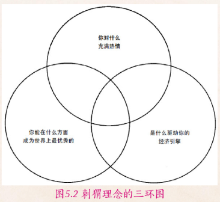
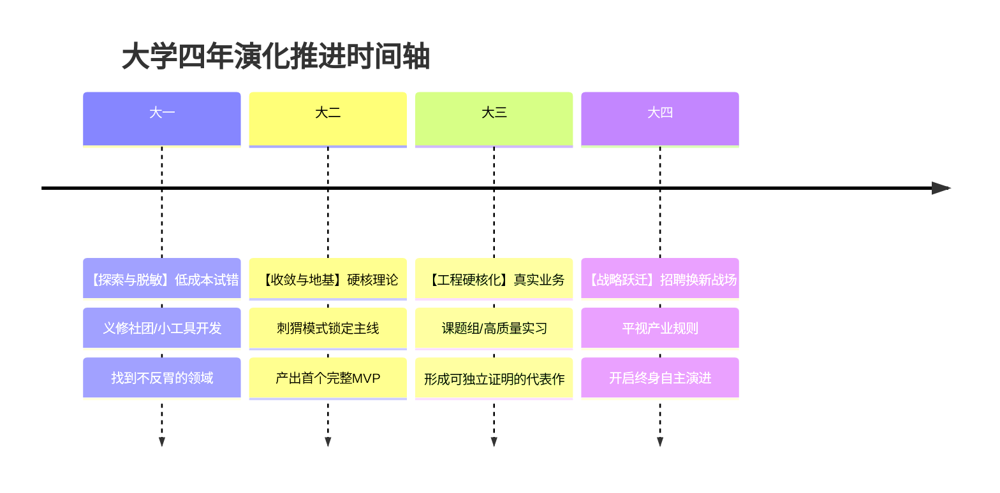

# 四年学习规划

## 背景

一名电信专业的大一新生，初入大学对未来的学习规划感到迷茫与渺茫。

>  **求助内容摘录**：
>
> 初入大学，对目前的学习规划还比较渺茫。如果要以进入大厂为目标，那大学四年应该在什么方向上多努力呢。课本内的知识对以后进入大厂的帮助大吗，课外自己又应该多了解哪些方面


## 分析与答复

**“初入大学感到渺茫，不仅不是危险的信号，反而说明你终于开始脱离高中的提线木偶状态，直面真实的世界了。”**

大学突然把四面八方的围墙拆除了，你手握空前自由的时间，站在荒原中间，看不见既定跑道。此时的“渺茫”，在哲学上被称为**“自由的眩晕”**——你感知到了选择的重力。你希望我或某位资深前辈能为你开出一张“四年精准规划图”，我猜测你在心中有可能像找游戏通关攻略一样希望告诉你：“大一学什么、大二考什么证书、课内课外按什么比例分配，就能百分之百稳进大厂”。

我很坦白地告诉你：**没有任何靠谱的人能给你一张保真四年的“大厂施工图”。** 如果有人信誓旦旦地卖给你这样一张路线图，他要么是在贩卖焦虑割韭菜，要么是他自己还在按十年前刻舟求剑的旧逻辑生活。

讲道理能论证，讲故事能调动情绪。以下是我基于自己在深大从“浑浑噩噩试错”到“斩获大厂”、以及后来在产业界复盘所总结的核心认知主线：

---

### 一、 破除伪对立：课本内的理论知识，对进大厂到底有多大用？

你问：“*课本内的知识对以后进入大厂的帮助大吗？课外自己又应该多了解哪些方面？*”

很多大学新生的认知极易滑入两个极端：
* **极端一（死磕型做题家）**：以为大学和高中一样，只要把课本每道课后习题做对、考个 95 分，大厂 Offer 就会像保研名额一样自动发到手上；
* **极端二（浮躁型实用主义）**：看到网上或学长说大厂面试考 Vue、React、Spring Boot、AI 调优，就觉得课本上的数学、电路、计算机网络、操作系统全是落后淘汰的屠龙之术，弃之如敝履。

这两种极端都把“课内与课外”割裂成了简单的二元对立。**我们需要用“知识的半衰期理论”来重新审视它们：**

```
【知识的双层金字塔模型】

      ▲
     / \     【应用层 / 课外生态】（低半衰期：2~3 年演进周期）
    /   \    框架、语法糖、开发工具、大模型 API、工程脚手架
   /-----\   👉 决定你今天能不能快速上手干活、面试简历有没有可聊的落地项目
  /       \  
 /         \ 【地基层 / 课内理论】（高半衰期：10 年不衰退）
/___________\微积分、离散数学、数据结构、计网、体系结构、操作系统、编译原理
             👉 决定你五年后是成为无可替代的系统架构师，还是沦为被 AI 淘汰的代码搬运工
```

1. **课内知识是你的“抗衰期地基”**：
   * 你在深大电信专业学的高数、信号与系统、计算机系统结构、操作系统，不是为了让你在期末考卷上默写概念，而是人类几十年来构建整个数字世界的底层数学和物理公理。
   * **现实的残酷在于**：大厂在初筛时，看重的是你在课外能不能迅速用最新的框架把业务跑通；但在技术深度面试、定薪定级、以及遭遇线上核心系统崩溃时，考察的**全部是课内那些底层硬核原理**。没有底层原理的人，在 AI 时代只能当一个“报错复读机”。
2. **课外实践是你的“敏捷抓手”**：
   * 课本知识更新周期长，不可能教你大模型 Agent 架构、云原生、现代工程协作流。这些必须依赖你在“自由支配的闲暇”里，通过真实的项目、开源社区和工程踩坑去自学。

---

### 二、 方法论重构：两阶段演进

#### 破局之道：大学四年的“双相演进模型”

```
【第一阶段：大一】                     【第二阶段：大二至大四】
 探索者模式 (Breadth-first)             狙击手/刺猬模式 (Depth-first)
  • 不求做深，只求去神圣感              • 发现甜蜜点，主动收拢战线
  • 敏捷低成本试错                      • 硬核工程闭环，打造招牌作品
  • 建立广阔的知识感知网                • 撬动外部资源，实现刺猬三环交集
```

* **大一的核心是【探索者模式】（广度优先）**：
  * **行动判据**：只要成本低、只要没接触过，就大胆去碰。加入社团、参加一次学院的比赛、写一个小工具、配一配 Linux 服务器。
  * **目的不是拿奖，而是获得真实的“体感反馈”**：让你知道自己面对枯燥的单片机硬件是兴奋还是反胃；面对调不通的 CSS 样式是有探索欲还是抓狂。**及早发现自己“讨厌什么”，与发现自己“热爱什么”同等重要！**
* **大二大三的核心是【狙击手模式】（深度优先 / 刺猬理念启动）**：
  * 在大一撞过几堵墙之后，你手里有了实打实的体感数据。这时再启动刺猬理念：选定 1~2 个你最不反胃、甚至在解决问题中获得过心流的方向，收拢战线，深挖底层，做出经得起考验的闭环作品。
  * 当然，刺猬理念仅作参考，这3个圈对大学生而言可能都是伪命题。但作为一种迷茫时的参考还算有点作用。
    * 你根本没写过几千行代码，你凭什么知道自己对前端、后端、嵌入式还是算法真正**“感兴趣”**？
    * 你连行业里的顶级工程师长什么样都没见过，你从何判断自己能否**“做到顶尖”**？
    * 技术的商业逻辑错综复杂，纯粹在校内看，你如何准确衡量**“经济驱动”**？
  *  刺猬理念模型《从优秀到卓越》

---

### 三、 我的真实翻车故事复盘：一个普通人的反脆弱成长

原草稿中，我记录了自己在深大几年浑浑噩噩、看起来毫无光彩的大学经历。今天我把这些踩坑的实情彻底摊开给你看：

* **单片机蓝牙风速调节**：大一训练营项目，在没有 AI 的时代硬啃完成，拿了个 A，还算不错，这是我对本专业的一点基础理解，基础工程能力的映证；
* **PPT 制作与设计**：帮“荔园之星”打磨优化毕设答辩 PPT，动画配色拿捏到位，这看似与写代码无关，但能训练了我的**审美与叙事能力**；
* **数学建模竞赛**：熬了个通宵，代码没写明白，队友的设想无法落地，最后连论文都没交成，体验了一次彻底的惨败；
* **实验室大横向开发**：代码写得稀烂，交付时一堆 Bug，战战兢兢，但在实战泥潭里摸爬滚打，逼着我学会了如何进行多人协作以及“草台班子”这个词；
* **计算机比赛套壳炫技**：和别人组队，把精力全浪费在花哨的 UI 动画上，底层核心逻辑毫无壁垒，最终颗粒无收；
* **荔园创业赛网站开发**：负责全栈实现，虽然最后水了一张校级奖状，但我知道那个项目根本没有真实用户，离商业闭环差了十万八千里；
* **两次字节跳动青训营（前端/后端各一次）**：想当 Team Leader 却没有工程掌控力，队员中途跑路，缺乏最小可行性产品（MVP）的边界管理意识和风险意识，最后答辩草草收场；
* **社团网站运维与开发**：勉强维持运行，但长期处于“规划画饼、无法落地”的拖延状态；
* **第一家公司实习**：踩遍无数坑后，积累下来的方法论帮助我三天速成 React 并高效推进业务，多次拿奖金；拿到大厂 Offer 后，因毕业答辩精力透支（最大的难点是论文不会写，不过好在后来靠PPT吹牛拿A）、情绪管理失控，在实习公司被“安静地辞退”。

可以说，在大学的前面3年，我几乎都是没什么成就，黯淡无光的。

#### 为什么经历过这么多狼狈与失败，我最终依然能拿到不错的Offer？

很多人看简历只看光鲜的终点，误以为牛人走的是一条笔直的康庄大道。
但这串看似“不靠谱、不理想”的黑历史背后，藏着一套底层成长逻辑：

1. **破除对技术的“神圣感与畏难心”**：
   * 没做过单片机、没碰过横向、没进过青训营之前，你会觉得那些名词高深莫测；当你真正跳进去摔得鼻青脸肿之后，你会发现**所有工程本质上都是一行行代码、一个个排障堆出来的**。你不再对技术心存迷信，这种脱敏是做成一切复杂系统的前提。
2. **在“真实失败”中掌握 MVP 思维与系统调试力**：
   * 数学建模的弃赛和青训营的崩盘，都狠狠教育了我：**不要一开始写太多需求** 必须用最快的速度把最核心的骨架（MVP）跑通，然后再迭代。
   * 那些横向项目交付时的满地 Bug，逼得我无数个深夜面对黑底白字的终端。**大学里最宝贵的不是你写了多少行能跑通的代码，而是你亲手定位并杀死了多少个绝望的 Bug。** 这种抗压与排障直觉，才是日后我能“三天速成 React”的底气所在。
3. **大学试错成本趋近于零**：
   * 在大学里，比赛没交卷、项目写出 Bug、社团画了饼，承担的最大代价无非是丢脸或少拿一张奖状；但如果这些错误留到你参加工作、负责百万用户核心业务时再去犯，代价就是背绩效 PIPS、开除甚至法律责任。**大学四年就是上天赐予你的“试错安全沙盒”！**

> [!NOTE] 💡 
>
> 纳西姆·塔勒布在《反脆弱》中提出，面对不确定性的最好策略不是做出精密刚性的预测，而是保持**“小规模且高频的试错（凸性偏好）”**。每一次低成本的碰壁，都是在以极低的代价排除错误假设、吸收现实压力，进而使整个人的适应系统在冲击中变得更加强韧。

---

### 四、 落地实操：四年演进时间轴与关键判据

不用抽象的口号，请收下这张贯穿四年的节奏表与行动判据：（当然，如果我能照做成功，我现在估计钱更多了）



下面是AI的指导意见：

#### 1. 大一：脱敏探索期（广度第一，不怕翻车）

* **核心目标**：脱离做题家惯性，熟悉工具链，破除对计算机/电子技术的畏惧感。
* **具体动作**：
  * 把社团当做练兵场：亲手装机、拆解系统、装 Linux、搞懂本地网络排障；
  * 课内把高数、C语言/Python 学扎实，课后自己跟着教程从零手写一个小网站或爬虫小工具；
  * 积极参加学院组织的新手赛或训练营，哪怕第一轮被刷掉也必须走完流程。
* **关键判据**：到大一下学期结束时，你能否指着具体方向说出：*“这个方向我试过，我确实不喜欢；而那个方向折腾一整天我不觉得累。”*

#### 2. 大二：收敛与地基期（深度第一，刺猬启动）
* **核心目标**：收拢战线，吃透高半衰期课内基础，产出第一个具备完整生命周期的项目。
* **具体动作**：
  * **课内狠抓基础**：数据结构、计算机网络、操作系统。遇到理论疑惑，应当用代码亲自验证；
  * **开启刺猬模式**：选定 1 个细分领域（如全栈开发、AI Agent、嵌入式等某个方向），不再到处乱晃；
  * **完成一个 MVP 闭环**：不要只写玩具 Demo，而是开发一个能稳定运行在云服务器上、有前端界面、有数据库存储、有基础错误处理的完整小应用。
* **关键判据**：你能否在 GitHub 上公开一个自己从头构思、独立部署、持续运行超过一个月的项目仓库，并在 README 中清晰写明架构设计与排障复盘？

#### 3. 大三：工程实战与反脆弱期（交付第一，资源撬动）

* **核心目标**：从“个人玩具代码”跃迁为“工业级协同交付”，撬动外部资源，拿下高质量实习。
* **具体动作**：
  * **主动撬动导师与行业资源**：进入实验室参与真实课题，或者向学长、社区寻找开源共建机会；
  * **打磨工程素养**：引入自动化测试、CI/CD、日志监控、并发处理（AI时代来临，这个其实可以在大一就尝试）；
  * **大三下学期冲刺暑期实习**：以解决问题的实际案例（而不是死记硬背的八股文）直面大厂技术面试。
* **关键判据**：面对面试官追问“这个系统挂了你怎么定位”，你能否条理清晰地讲出 3 个你在真实环境中亲自排查过的棘手 Bug 及其根因？

#### 4. 大四：秋招变现与主体跃迁（平视大厂，蓄势待发）
* **核心目标**：收获确定性结果，完成从学生到独立工程师的心智交接。
* **关键动作**：秋招收获 Offer，在毕业设计中攻克一个有深度的问题，做好职场管理与职业开局。

---

### 五、 审视：事业打拼不是谈恋爱，大厂也不是你人生的最终庙宇

> *“事业打拼不是谈恋爱，不用先看自己有什么资源，而是看自己愿不愿意做，然后想尽各种办法去撬动资源，反复尝试。”*

很多同学总觉得：“我必须先把所有知识学完、把所有技能点满、手握足够的人脉和资源，我才配去推进一个大项目，才配去申请大厂。”  
**这是典型的学生思维。**

真实商业社会的逻辑恰恰相反：**所有的资源都是被“具体的愿望和推进动作”撬动出来的。**  
你想要做一个管理系统，你手头没有服务器，你就本地搭建，搭好后拉上社团同学试用，然后拉赞助；在这个过程中，你才顺便学会了 Docker、学会了数据加密、学会了团队协作。不是有了资源才去干事，而是你在干事的过程中，资源才会向你汇聚。

最后，我想送你一点超越“大厂功利主义”的哲学提醒：

> [!NOTE] 💡 
> 
> 哲学家海德格尔曾警示，现代技术体系有一种危险的魔力，它会把一切存在者都纳入“座架（Gestell）”之中，将万事万物（包括人自身）变成等待被调用、被消耗的“持存物（Standing-reserve）”。如果你把大学四年的唯一目的定义为“把自己改造成最符合大厂口味的合格螺丝钉”，你就在不知不觉中把自己当成了人力市场上的消耗品。**不要让大厂的招聘需求定义你生命的全部意义。** 大厂只是一个资源丰富、让你见识大规模工程协作的优质平台。你要做的是借大厂的势能来淬炼你解决真实复杂问题的本领，最终成为一个**精神独立、具备不可替代创造力的自由人**。

放轻松，不用害怕眼前的迷茫。带上你的好奇心，去修好第一个BUG，去主动踩第一个坑。
